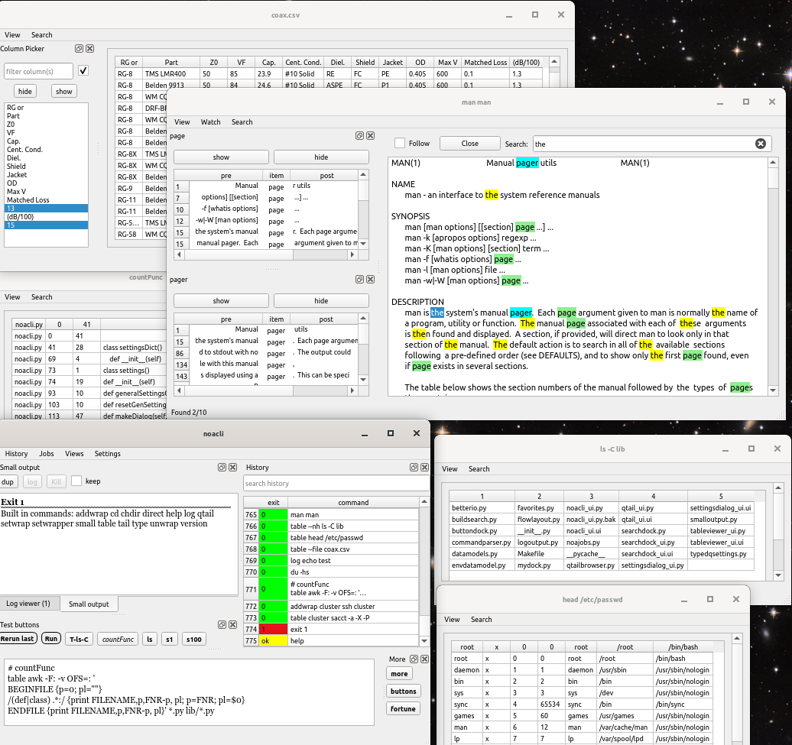
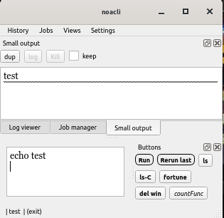
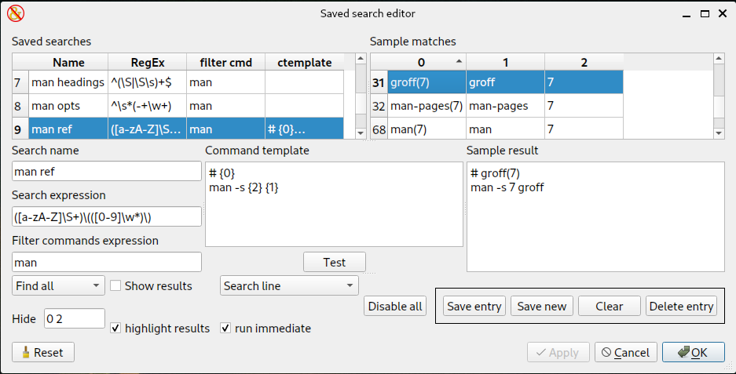
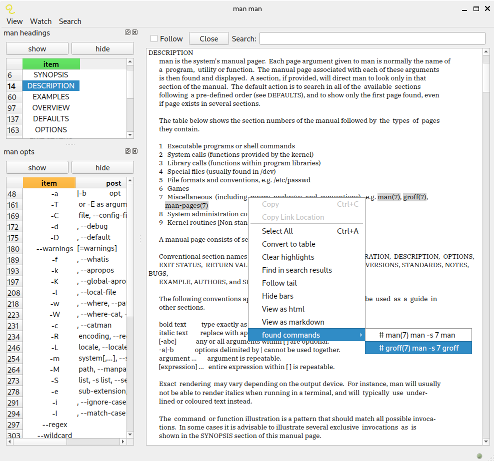

[GUICLI](https://github.com/mwakidenis/guicli): a smarter command-line experience

GUICLI is a hybrid graphical and command-line shell that combines traditional
command execution with interactive graphical tools for process management,
output inspection, log monitoring, command history, saved searches and
structured data visualization.

It tries to use the command line interface where that is most efficient,
and graphical interface elements where that can be more efficient.

This is the short description. For a longer list of features, see
[documentation/Readme.md](documentation/Readme.md).

GUICLI does most things regular CLI shells do (except full parsing and
Turing complete programming), but in a graphical interface. GUICLI takes
full advantage of having a GUI as much as possible, including common
trivial data visualization stuff.

GUICLI tries to make the following concepts obsolete:
* terminal based text pagers
* background jobs
* waiting for jobs to complete before starting another
* terminal multiplexers
* terminal based scroll back buffers

This does not replace the standard terminal shell, but augments it and
hopefully reduces your need to ever open a second terminal, as
everything not done in the first terminal window can be done in
GUICLI. You would still want a traditional terminal window for
things like:

* Full screen text applications like vi, nethack
* Text based applications expecting input from the terminal
* Other programs expecting a terminal like sudo

GUICLI includes three stand-alone but integrated programs:
* The main GUICLI shell window
* The qtail file viewer
* The tableviewer

The main shell window is a single command editor pane coupled with a
few pull down menus, some settings editors and a number of
rearrangable dock windows.

the docks are:
* The small output dock
* The history dock
* The job manager dock
* The combined log dock
* The favorites button dock

The settings editor dialog boxes are:
* General settings editor
* Favorites editor
* Environment variable editor
* Button dock editor
* Saved search editor

For a longer list of features and details of the above features,
see [documentation/Readme.md](documentation/Readme.md).

The main window is composed of docks that can be rearranged and hidden, and
various configurations saved. Here's some alternate configurations.

[See more screenshots](documentation/screenshots.md)

The buttons in the button dock in these screenshots are user configurable
commands marked as favorites.

If you want to see where this project is going or want to influence it,
look at [Readme-feedback.md](documentation/Readme-feedback.md) and documentation/noacli-ideas.txt

The saved search editor allows creation of searches that automatically
run on output of matched commands. This could be used to find, for
instance, interesting output in a frequently visited debug log, or to
build a table of contents from a structured text file, or to run
commands to view related documents.

For example, given these three searches:
* man headings: ^(\S|\S\s)+$
* man opts: ^\s*(-+\w+)
* man ref: (\S+)\(([0-9]\w*)\)

The man headings will extract heading lines from the man page that do
not contain multiple consective spaces, run a find all search and display
the results.

The man options will similarly display the list of lines that look
like option descriptions.

The man ref line is set to not show the results, but instead highlight
the results, and also if a line is right clicked (as below), the group
results from the search can be used to fill in a template to generate
a commands to follow the references on the line.

## Installation

GUICLI is a Python desktop application built on PyQt6. It targets
Windows 11 and runs wherever Python 3 and PyQt6 are available.

### Prerequisites

* Python 3 (tested with Python 3.8 and 3.11)
* PyQt6 (tested with Qt 6.4 and 6.11)

On Ubuntu/Debian:

    sudo apt install python3-PyQt6

On macOS:

    pip3 install --user pyqt6

or:

    sudo pip3 install pyqt6

### Running

Clone this repository and run the main shell:

    python noacli.py

The entry point remains `noacli.py` for compatibility with the original
project. The application presents itself as GUICLI.

## Usage

Launch GUICLI and type a command into the command editor, then press
Ctrl-Enter (or the run button) to execute it. Output is shown in the
small output dock and, for longer output, in a qtail window.

Command execution examples:

    # run a directory listing
    dir

    # view a file with qtail
    qtail --file README.md

    # parse command output as a table
    table --file some.csv

Background job management:

Jobs you run are tracked in the job manager dock window, which shows the
critical job details and status and helps you find or reopen lost
windows. Finished jobs with closed windows can be manually cleared or
will automatically clear after a timeout. Double click on the window
name or mode in the job manager to raise the window.

Output and log monitoring:

The combined log dock collects output from multiple commands at once and
tags each line with the process ID. The small output dock collects brief
command output and shows notifications in the status bar.

Saved searches:

The saved search editor lets you create searches that automatically run
on the output of matched commands, with options to show, highlight or
hide results.

## Configuration

All shell settings can be adjusted in a graphical settings edit window
that includes tooltips with default values and documentation for each
setting. The settings editors are:

* General settings editor
* Favorites editor
* Environment variable editor
* Button dock editor
* Saved search editor

## License

This project (and this file) are Copyright (C) 2022, 2023, 2024 Steven
Dick and may be used under the terms of the GNU General Public License
v3, which is included with this project in the file license.txt.

GUICLI is the new public identity for this project. The original
upstream project was published as Noacli by Steven Dick
(https://github.com/kg4ydw/noacli), and its original licensing,
copyright and contributor attribution are preserved.
